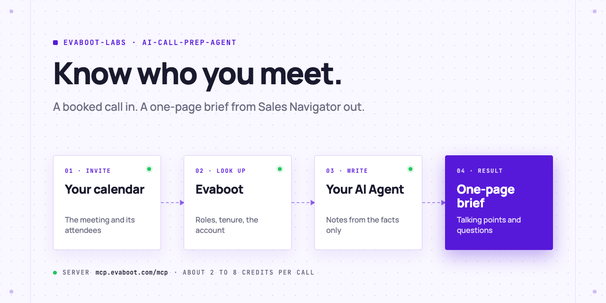
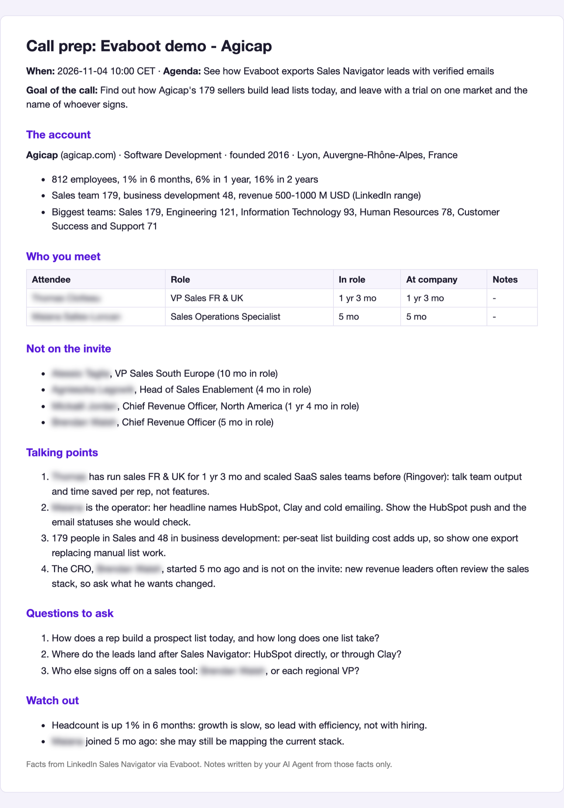
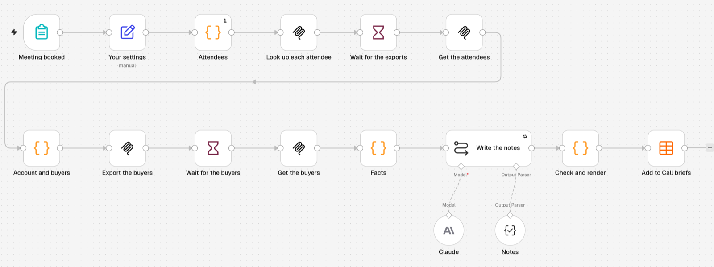

<picture>
  <source media="(prefers-color-scheme: dark)" srcset=".github/assets/banner-dark.png">
  
</picture>

# AI call prep agent

Before every booked sales call, your AI Agent looks up the attendees in LinkedIn Sales Navigator with Evaboot, pulls the account's size, growth and sales team, finds the buyers who are not on the invite, and writes a one-page brief: who you meet, how long they have held their role, what to talk about and what to ask.

[](AGENTS.md)
[](https://evaboot.com/mcp)
[](LICENSE)

## Set it up in one prompt

Paste this into Claude Code, Codex or Cursor:

```text
Clone https://github.com/evaboot-labs/ai-call-prep-agent, read AGENTS.md and follow the skill. Then prepare my call with <attendees> at <company>.
```

<details>
<summary>Or install the skill</summary>

Claude Code:

```text
/plugin marketplace add evaboot-labs/ai-call-prep-agent
/plugin install ai-call-prep-agent@evaboot-labs-ai-call-prep-agent
```

Codex, Cursor and other agents:

```bash
npx skills add evaboot-labs/ai-call-prep-agent
```

</details>

## How it works

**1. Each attendee, from Sales Navigator.** Your agent reads the invite (or your calendar), drops your colleagues, and exports each attendee with Evaboot: role, time in role and at the company, verified email. Then up to 5 buyers at the same company who are not on the invite.

**2. One page, from facts only.** `prep.py` turns the exports into facts, your agent writes the talking points and questions, and `prep.py check` refuses any number that is not in the facts.



**3. Every morning, or in n8n.** Schedule it on tomorrow's meetings, or run the same flow in n8n from a form or a calendar trigger.



## What you need

- An [Evaboot account](https://dash.evaboot.com/accounts/signup/?last_click_origin=ai-call-prep-agent-repo) and a Sales Navigator seat.
- Claude Code, Codex, Cursor, or Claude on the web with the Evaboot connector. A calendar connector is optional.
- Cost: 1 Evaboot credit per person looked up, about 2 to 8 per call.

## Go further

| Page | For |
|---|---|
| [MEETING.md](MEETING.md) | What you sell and who your buyers are |
| [docs/connect-your-agent.md](docs/connect-your-agent.md) | The Evaboot MCP server, by hand, for each agent |
| [docs/schedule.md](docs/schedule.md) | A brief every morning for tomorrow's meetings |
| [docs/n8n.md](docs/n8n.md) | The same agent in n8n |

---

Agents: start at [AGENTS.md](AGENTS.md) · Built by [Evaboot](https://evaboot.com) · More workflows at [github.com/evaboot-labs](https://github.com/evaboot-labs) · [MIT license](LICENSE)
